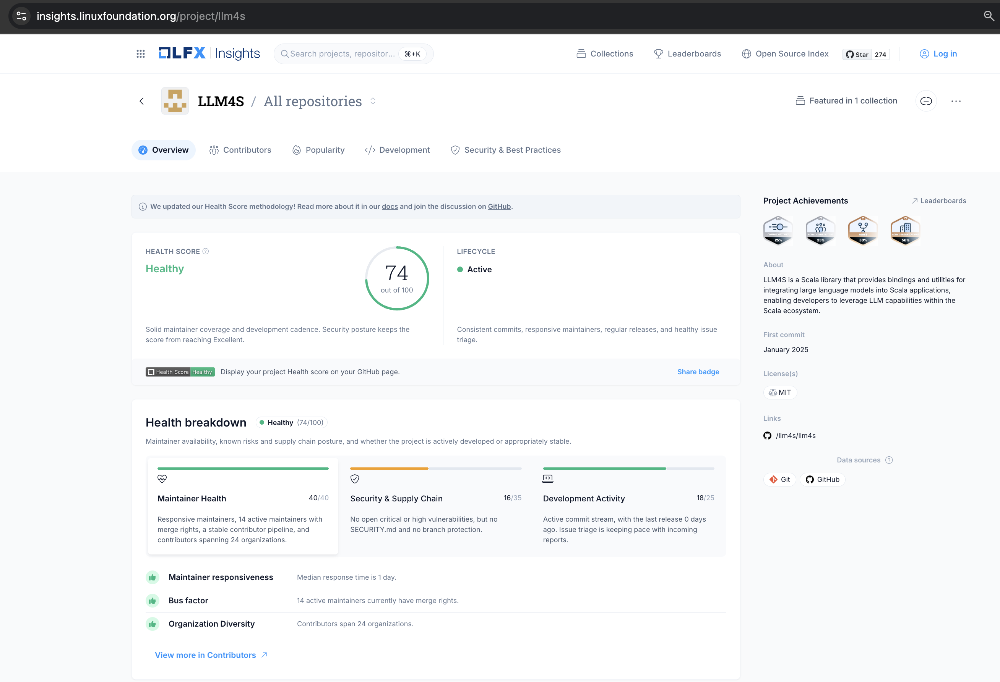
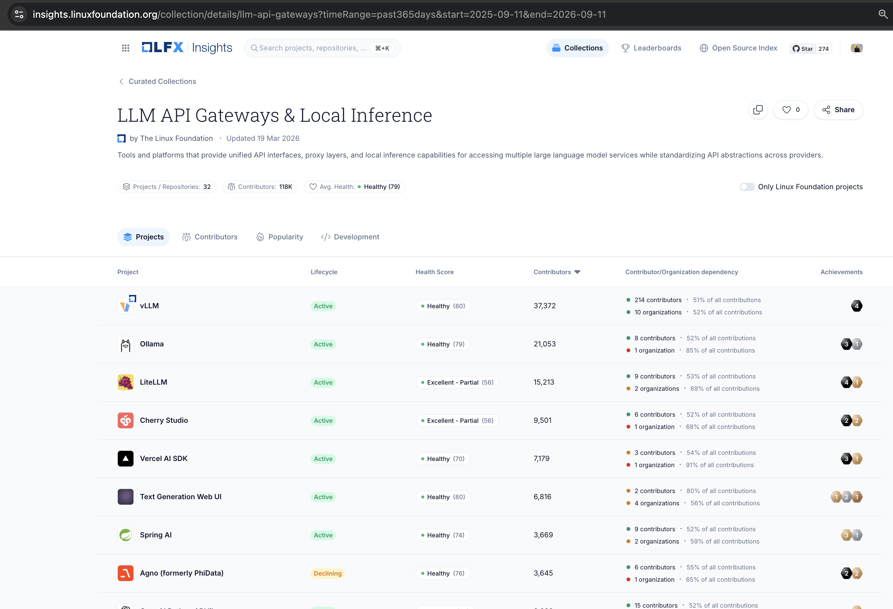

# LLM4S - Large Language Models for Scala


**Scala 3 and JVM toolkit for LLM applications: one typed API over OpenAI, Anthropic, Gemini, Ollama and a dozen
more providers, with agents, tool calling, RAG, guardrails, memory and tracing.**

[Website](https://llm4s.org) · [Getting started](https://llm4s.org/getting-started/) ·
[Docs](https://llm4s.org/guide/) · [Scaladoc](https://llm4s.org/api/) · [Discord](https://discord.gg/4uvTPn6qww)

[](https://central.sonatype.com/artifact/org.llm4s/llm4s-core_3)
[](https://github.com/llm4s/llm4s/blob/main/LICENSE)
[](https://codecov.io/gh/llm4s/llm4s)
[](https://discord.gg/4uvTPn6qww)

```scala
// build.sbt (Scala 3.7, JDK 21): llm4s-core plus your provider's module (llm4s-anthropic, llm4s-gemini, llm4s-ollama, ...)
libraryDependencies ++= Seq("org.llm4s" %% "llm4s-core" % "0.5.1", "org.llm4s" %% "llm4s-openai" % "0.5.1")
```

```scala
import org.llm4s.config.Llm4sConfig
import org.llm4s.llmconnect.LLMConnect
import org.llm4s.llmconnect.model.{ Conversation, UserMessage }
import org.llm4s.model.ModelRegistryService

val answer = for {
  providerConfig <- Llm4sConfig.defaultProvider() // the section application.conf names, below
  registry       <- Llm4sConfig.modelRegistryService()
  given ModelRegistryService = registry
  client     <- LLMConnect.getClient(providerConfig)
  completion <- client.complete(Conversation(Seq(UserMessage("In one sentence, what is Scala?"))))
} yield completion.content

answer.fold(error => println(s"Error: ${error.formatted}"), text => println(text))
```

With `OPENAI_API_KEY` set, this `src/main/resources/application.conf` is all the configuration it needs (or point it at
a local [Ollama](https://llm4s.org/getting-started/ollama-quickstart) model with no key):

```hocon
llm4s.providers {
  provider = "openai-main"   # the default: the name of a section below
  openai-main { provider = "openai", model = "gpt-4o-mini" }
}
```

## Getting started

**Scala CLI**, no build: save the snippet above as `hello.sc` under these lines, then `scala-cli run hello.sc`
([Scala CLI quick start](https://llm4s.org/getting-started/scala-cli)).

```scala
//> using scala 3.7.1
//> using dep org.llm4s::llm4s-core:0.5.1
//> using dep org.llm4s::llm4s-openai:0.5.1
```

**Java (Maven or Gradle)**: `llm4s-java-api` brings the core, the agent runtime and the provider modules. Maven does
not add the Scala suffix, so write `_3` yourself ([Java guide](https://llm4s.org/guide/java),
[Maven](https://llm4s.org/getting-started/maven), [Gradle](https://llm4s.org/getting-started/gradle),
[JBang](https://llm4s.org/getting-started/jbang), [Spring Boot starter](https://llm4s.org/guide/spring-boot)):

```java
// Gradle: implementation("org.llm4s:llm4s-java-api_3:0.5.1")
try (JLlmClient client = Llm4s.createDefaultClient().get()) {   // the same application.conf
    client.complete("In one sentence, what is Scala?").ifSuccess(System.out::println);
}
```

**Kotlin**: `llm4s-kotlin-api` wraps the Java facade in suspend functions and `Flow`s
(in a coroutine, `Llm4s.createDefaultClient().use { println(it.complete("What is Scala?")) }`). It is not on Maven Central yet;
[installation](https://llm4s.org/getting-started/installation#for-kotlin-coroutines-and-flow) shows how to build it.

**A new project**: the [llm4s.g8 starter kit](https://github.com/llm4s/llm4s.g8) generates one with CI, formatting and
tests ([starter kit guide](docs/llm4s-g8-starter-kit.md)):

```bash
sbt new llm4s/llm4s.g8 --name=<your.project.name> --package=<your.organization> --llm4s_version=0.5.1
```

From there: [first steps](https://llm4s.org/getting-started/first-example) walks through the API, the
[installation guide](https://llm4s.org/getting-started/installation) covers the BOM (`llm4s-bom`) and every optional
module, and the [cookbook](https://llm4s.org/examples/cookbook) has complete programs that run with no API key. The
[doctor](https://llm4s.org/reference/doctor) checks a setup in one run - the JDK, the provider section, its module and
its API key - and prints the fix for each step that fails.

## Features

- **[Providers](https://llm4s.org/guide/providers)** behind one `LLMClient`, with streaming, tool calls, reasoning
  modes and [structured output](https://llm4s.org/guide/structured-output) derived from a case class.
- **[Agents](https://llm4s.org/guide/agents/)**: tools, guardrails, handoffs, memory, human-in-the-loop approvals,
  streaming events and durable checkpoints, from one agent to a multi-agent graph.
- **[Tool calling](https://llm4s.org/guide/custom-tools)** with typed parameters, plus
  [built-in tools](https://llm4s.org/guide/builtin-tools) and Model Context Protocol clients and servers (`llm4s-mcp`).
- **[RAG](https://llm4s.org/guide/vector-store)**: embeddings, vector stores (pgvector, Qdrant, Elasticsearch,
  Redis, ...), hybrid search, reranking, permission-aware retrieval and [RAGAS evaluation](https://llm4s.org/guide/rag-evaluation).
- **[Observability](https://llm4s.org/guide/observability/)**: console, Langfuse and OpenTelemetry tracing, Prometheus
  and Micrometer metrics, token and cost tracking.
- **[Reliability](https://llm4s.org/reliability-guide)**: retries, circuit breakers, rate limits, provider fallback and
  [caching](https://llm4s.org/guide/caching).
- **[Images, speech and multimodal input](https://llm4s.org/guide/multimodal)**, and a containerised
  [workspace](https://llm4s.org/reference/workspace-sandbox) for running agent tools in isolation.
- **Your stack**: [Java](https://llm4s.org/guide/java), Kotlin, [Spring Boot](https://llm4s.org/guide/spring-boot),
  [cats-effect](https://llm4s.org/guide/cats-effect), [ZIO](https://llm4s.org/guide/zio),
  [Pekko](https://llm4s.org/guide/pekko) and a [testkit](https://llm4s.org/guide/testing-with-the-testkit) for your
  own tests.

## Why llm4s

- **Typed end to end**: errors are values (`Result[A]`), configuration is checked when it loads, and structured
  output is a case class, so mistakes surface at compile or load time rather than in production.
- **Small, modular dependencies**: `llm4s-core` has no vendor SDK; each provider, store and tracing backend is a
  module you add only if you use it.
- **Built for the JVM**: one library for Scala, Java and Kotlin services, with the effect systems and frameworks you
  already run.

More in [Why LLM4S](https://llm4s.org/why-llm4s/). **Choosing a library?** [Comparing LLM4S](https://llm4s.org/guide/comparison)
sets it beside LangChain4j, Spring AI, Koog and Embabel, with a source and a date for every claim, and
[Migrating from LangChain4j](https://llm4s.org/guide/migrating-from-langchain4j) maps its concepts to LLM4S.

## Providers

OpenAI, Anthropic, Azure OpenAI, Google Gemini and Vertex AI, Ollama, DeepSeek, AWS Bedrock, Mistral, Cohere,
OpenRouter, Requesty, Z.ai, xAI, IBM watsonx.ai, and any OpenAI-compatible `/chat/completions` endpoint by
configuration alone (Groq, Together, Fireworks, vLLM, LM Studio, llama.cpp, ...). Embeddings from OpenAI, Voyage,
Jina, Cohere and Ollama. See [providers](https://llm4s.org/guide/providers) for each one's module, the
[capability and tested-versions matrix](https://llm4s.org/reference/compatibility-matrix) generated from the code, and
[writing a provider](https://llm4s.org/guide/writing-a-provider) to add your own.

## Status

The latest release is **0.5.1** ([release notes](https://github.com/llm4s/llm4s/releases/tag/v0.5.1)), for Scala 3.7.x
(built with 3.7.1) on JDK 21. LLM4S is under active pre-1.0 development: the APIs are usable today and are being
stabilised ahead of the 1.0 compatibility commitment. See the [roadmap](https://llm4s.org/reference/roadmap), the
[1.0 scope](https://llm4s.org/reference/v1-scope) and, upgrading from 0.4.x,
[Upgrading from 0.4.1 to 0.5.0](https://llm4s.org/migrations/0-4-1-to-0-5-0). The module history and design notes
that used to be here are in [project history](docs/contribute/project-history.md).

## Community

- **[Discord](https://discord.gg/4uvTPn6qww)** for help and discussion, and the weekly
  [LLM4S Dev Hour](https://llm4s.org/events/), every Sunday at 09:00 London time.
- **[Talks, sessions, GSoC and blogs](docs/community/talks-and-sessions.md)**: past and upcoming talks, the Dev Hour
  archive, Google Summer of Code and articles by contributors. See also [events](https://llm4s.org/events/) and
  [GSoC](https://llm4s.org/gsoc/).
- **Contributing**: start with [CONTRIBUTING.md](CONTRIBUTING.md) (building the repository, pre-commit hooks, IDE
  setup, running the samples, CI) and the [open issues](https://github.com/llm4s/llm4s/issues). To report a
  vulnerability, follow [SECURITY.md](SECURITY.md); please do not use a public issue.
- **Help and adopters**: [SUPPORT.md](SUPPORT.md) lists where to ask what; add your organisation to
  [ADOPTERS.md](ADOPTERS.md) if you use LLM4S. Evaluating LLM4S for your organisation? The
  [enterprise evaluation](https://llm4s.org/reference/enterprise-evaluation) page answers the usual intake questions,
  with links to the evidence and the known gaps. Please read our
  [Code of Conduct](https://github.com/llm4s/llm4s/blob/main/CODE_OF_CONDUCT.md).
- **Support the project** through the [LLM4S Foundation](https://llm4s.org/foundation/).

### Maintainers

- **Rory Graves** - [https://www.linkedin.com/in/roryjgraves/](https://www.linkedin.com/in/roryjgraves/) | Email: [rory@llm4s.org](mailto:rory@llm4s.org), [rory.graves@fieldmark.co.uk](mailto:rory.graves@fieldmark.co.uk) | Discord: `rorybot1`
- **Kannupriya Kalra** - [https://www.linkedin.com/in/kannupriyakalra/](https://www.linkedin.com/in/kannupriyakalra/) | Email: [kannupriya@llm4s.org](mailto:kannupriya@llm4s.org), [kannupriyakalra@gmail.com](mailto:kannupriyakalra@gmail.com) | Discord: `kannupriyakalra_46520`

## ⭐ Stars Over Time

<p align="center">
  <!-- star-history:start -->
<picture>
  <source media="(prefers-color-scheme: dark)" srcset="assets/star-history/star-history-dark.svg">
  
</picture>
<!-- star-history:end -->
</p>

## Project Momentum


[](https://deepwiki.com/llm4s/llm4s)
[](https://github.com/llm4s/llm4s/blob/main/CODE_OF_CONDUCT.md)

### Linux Foundation LFX Insights

LLM4S is now onboarded and tracked on **Linux Foundation LFX Insights**, providing an independent, data-driven view of project health, maintainer activity, development, contributors, and security practices. LFX Insights tracking does not mean that LLM4S is hosted by or part of the Linux Foundation.

This visibility helps contributors, adopters, and organizations evaluate the project's activity and sustainability, strengthening transparency, trust, and readiness for broader community and enterprise adoption.

<p align="center">
  <a href="https://insights.linuxfoundation.org/project/llm4s">
    
  </a>
</p>

**[View LLM4S on LFX Insights →](https://insights.linuxfoundation.org/project/llm4s)**

LLM4S appears in the [LLM API Gateways & Local Inference collection](https://insights.linuxfoundation.org/collection/details/llm-api-gateways) alongside widely adopted projects such as **Ollama, vLLM, LiteLLM, and Vercel AI SDK**. For developers exploring production-minded LLM infrastructure—especially on the JVM and Scala—this makes LLM4S easier to discover, compare, and explore. Collection inclusion provides category context; it does not imply ranking or endorsement.

<p align="center">
  <a href="https://insights.linuxfoundation.org/collection/details/llm-api-gateways">
    
  </a>
</p>

## Changelog & Migration

- [CHANGELOG.md](CHANGELOG.md) — full release history from v0.1.0 to present, following [Keep a Changelog](https://keepachangelog.com/en/1.0.0/) format
- [Migration guides](docs/migrations/) — step-by-step upgrade instructions between versions
  - [0.x → 1.0 consolidated guide](docs/migrations/0x-to-1x.md) — all breaking changes across the 0.x series
  - [v0.2.9 → v0.3.0](docs/migrations/v0.2.9-to-v0.3.0.md) — migrate throwing APIs to type-safe `Result[T]`

## License

This project is licensed under the MIT License - see the [LICENSE](LICENSE) file for details.
