# LLM4S People

LLM4S is an open-source library for agentic and LLM programming in Scala, This page documents the people
who build, maintain, and grow the project.

> **Membership is maintained via pull requests.**
> To update your entry or join a committee, open a PR editing
> [`people.md`](https://github.com/llm4s/llm4s/blob/main/people.md).
> See [`CONTRIBUTING.md`](https://github.com/llm4s/llm4s/blob/main/CONTRIBUTING.md) for the path
> from contributor to maintainer.

---

## Directors & Administrators

Directors set the project vision, approve major roadmap decisions, and are the primary
liaisons with sponsors, and conference programme committees.

| | Name | GitHub | LinkedIn |
|---|---|---|---|
| 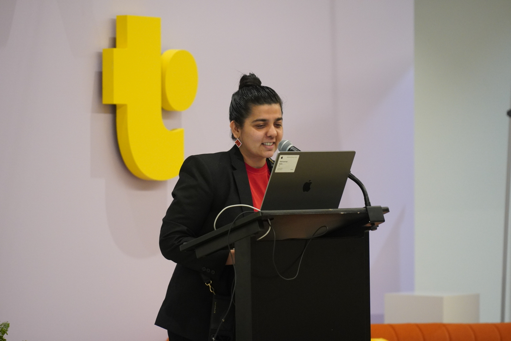 | **Kannupriya Kalra** | [@kannupriyakalra](https://github.com/kannupriyakalra) | [linkedin.com/in/kannupriyakalra](https://www.linkedin.com/in/kannupriyakalra) |
| 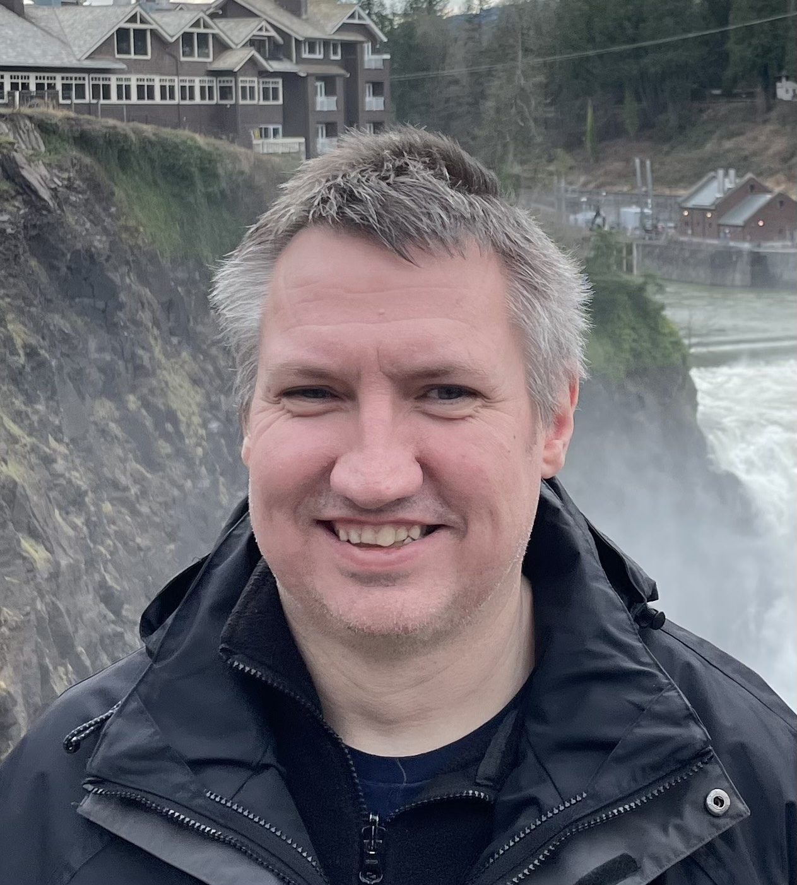 | **Rory Graves** | [@rorygraves](https://github.com/rorygraves) | [linkedin.com/in/roryjgraves](https://www.linkedin.com/in/roryjgraves) |

---

## Foundation Core Team

| Photo | Name | Role | LinkedIn |
|---|---|---|---|
| 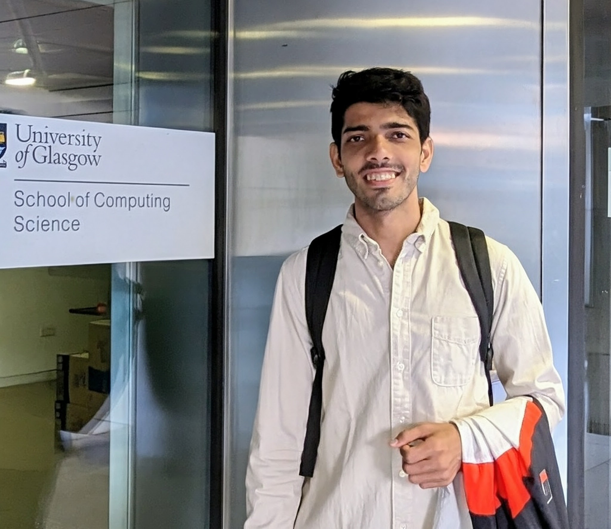 | **Gagandeep Kalra** | Foundation Core Team Member | [linkedin.com/in/gagandeep-kalra-9b23b2b1](https://www.linkedin.com/in/gagandeep-kalra-9b23b2b1/) |
| 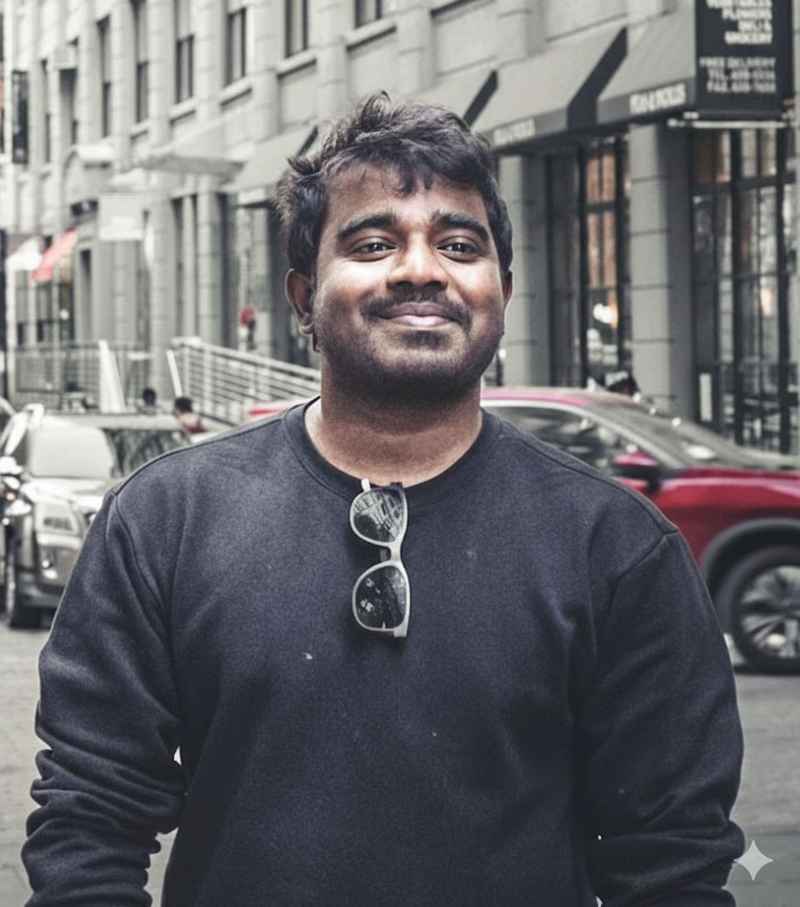 | **Pavan Vamsi** | Foundation Core Team Member | [linkedin.com/in/pavanvamsi3](https://www.linkedin.com/in/pavanvamsi3/) |
| 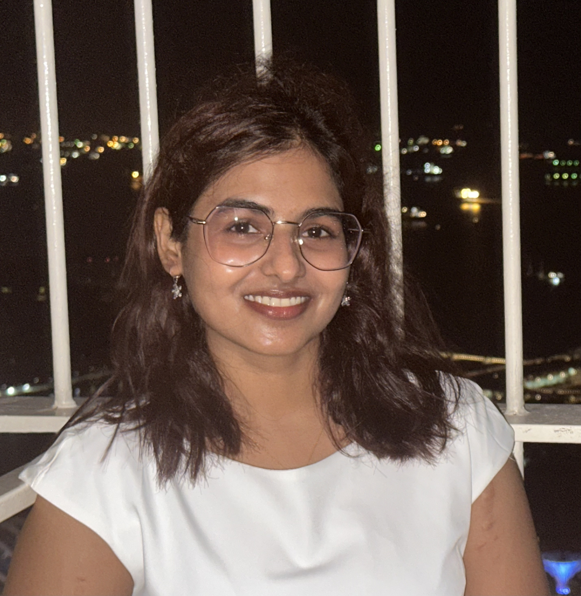 | **Namrata Priyadarshani** | Foundation Core Team Member | [linkedin.com/in/namrata-priyadarshani-61a316159](https://www.linkedin.com/in/namrata-priyadarshani-61a316159/) |
| 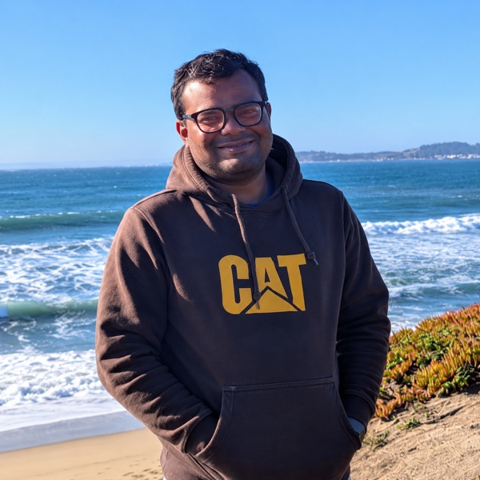 | **Ipsit Sahoo** | Foundation Core Team Member | [linkedin.com/in/ipsit-sahoo](https://www.linkedin.com/in/ipsit-sahoo/) |
| 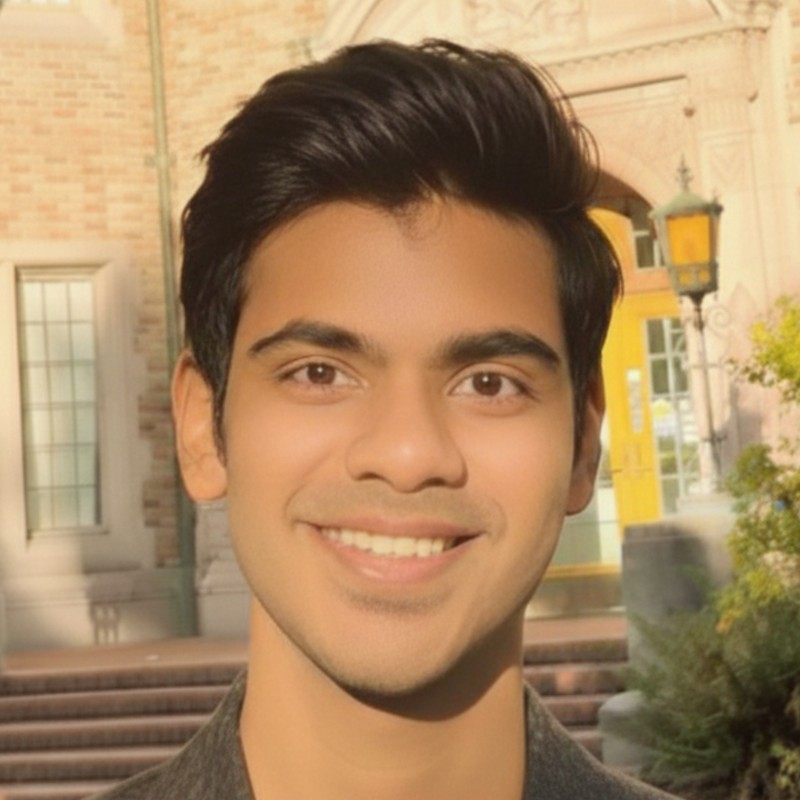 | **Ansh K Shah** | Foundation Core Team Member | [linkedin.com/in/ansh-k-shah](https://www.linkedin.com/in/ansh-k-shah/) |
| 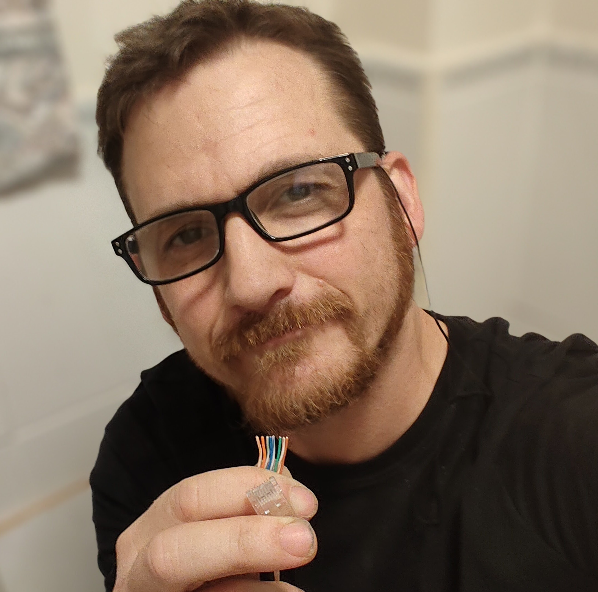 | **Christopher Wheeler** | Foundation Core Team Member | [linkedin.com/in/chris-w-1499161a](https://www.linkedin.com/in/chris-w-1499161a/) |

---

## LLM4S Global Chapter Leaders

| Landmark | Photo | Location | Name | Role | LinkedIn |
|---|---|---|---|---|---|
| 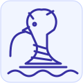 |  | 🇸🇬 Singapore | **Gagandeep Kalra** | Chapter Lead: Singapore | [linkedin.com/in/gagandeep-kalra-9b23b2b1](https://www.linkedin.com/in/gagandeep-kalra-9b23b2b1/) |
|  | 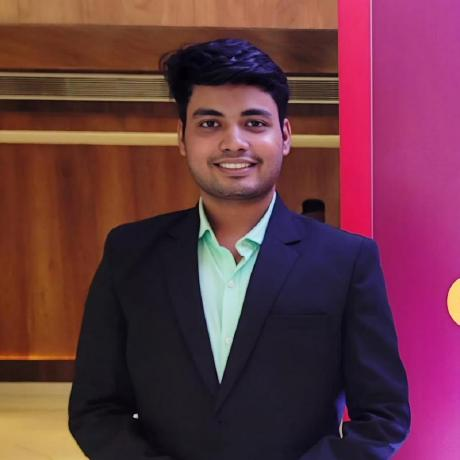 | 🇮🇳 Mumbai | **Shubham Vishwakarma** | Chapter Lead: Mumbai | [linkedin.com/in/shubham-vish](https://www.linkedin.com/in/shubham-vish) |
|  | 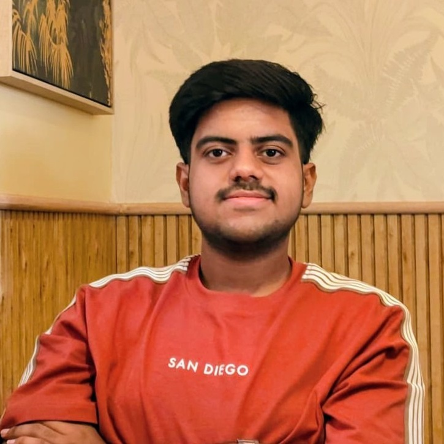 | 🇮🇳 Delhi | **Vansh Sharma** | Chapter Lead: Delhi | [linkedin.com/in/vansh-sharma007392325](https://www.linkedin.com/in/vansh-sharma007392325) |
| 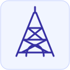 | 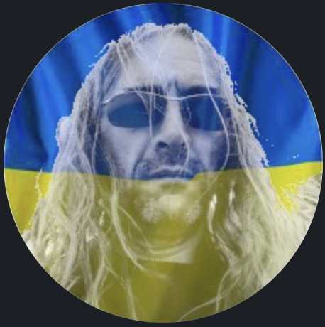 | 🇫🇷 France | **Olivier Nouguier** | Chapter Lead: France | [linkedin.com/in/olivier-nouguier](https://www.linkedin.com/in/olivier-nouguier/) |
|  | 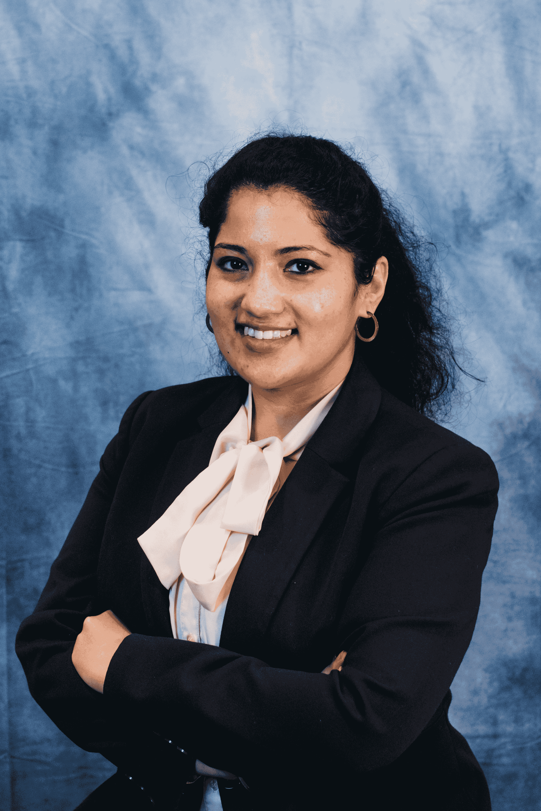 | 🇦🇪 Abu Dhabi | **Yoshita Sharma** | Chapter Lead: Abu Dhabi | [linkedin.com/in/yoshita-sharma-trojan](https://www.linkedin.com/in/yoshita-sharma-trojan/) |
|  | 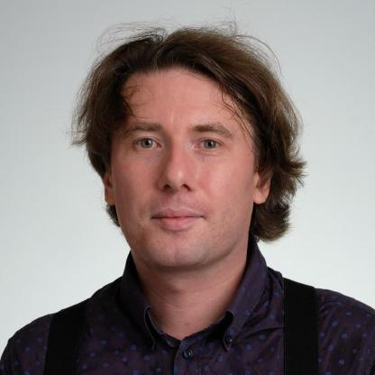 | 🇬🇧 London | **Dmitry Mamonov** | Chapter Lead: London | [linkedin.com/in/dmamonov](https://www.linkedin.com/in/dmamonov/) |
|  | 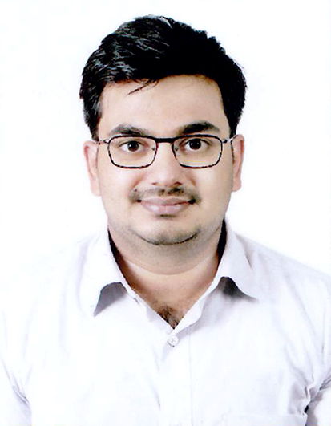 | 🇩🇪 Germany | **Vitthal Mirji** | Chapter Lead: Germany | [linkedin.com/in/vitthal10](https://www.linkedin.com/in/vitthal10/) |
|  | 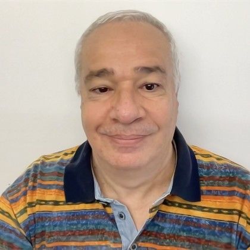 | 🇮🇹 Italy | **Giovanni Ruggiero** | Chapter Lead: Italy | [linkedin.com/in/giovanniruggiero](https://www.linkedin.com/in/giovanniruggiero/) |
| 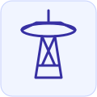 |  | 🇺🇸 Seattle | **Ansh K Shah** | Chapter Lead: Seattle | [linkedin.com/in/ansh-k-shah](https://www.linkedin.com/in/ansh-k-shah/) |
|  |  | 🇺🇸 Silicon Valley | **Ipsit Sahoo** | Chapter Lead: Silicon Valley | [linkedin.com/in/ipsit-sahoo](https://www.linkedin.com/in/ipsit-sahoo/) |
| 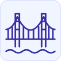 | 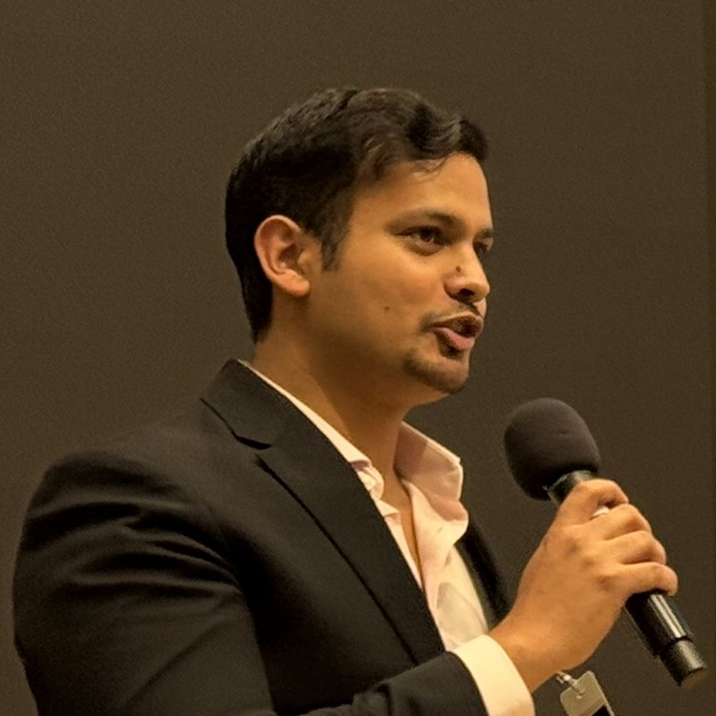 | 🇺🇸 San Francisco | **Pritish Yuvraj** | Chapter Lead: San Francisco | [linkedin.com/in/pritishyuvraj](https://www.linkedin.com/in/pritishyuvraj/) |
| 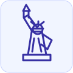 | 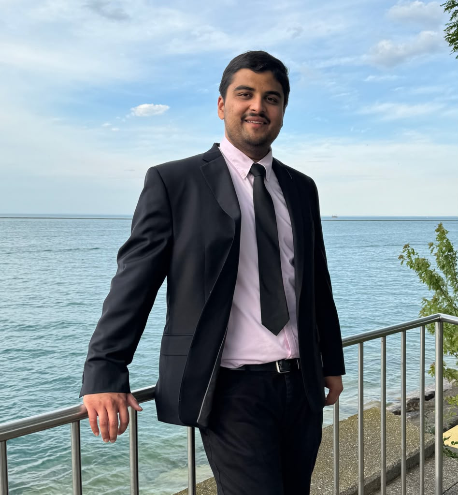 | 🇺🇸 New York | **Aatif Ullah** | Chapter Lead: New York | [linkedin.com/in/aatif-ullah-92308a49](https://www.linkedin.com/in/aatif-ullah-92308a49/) |
|  | 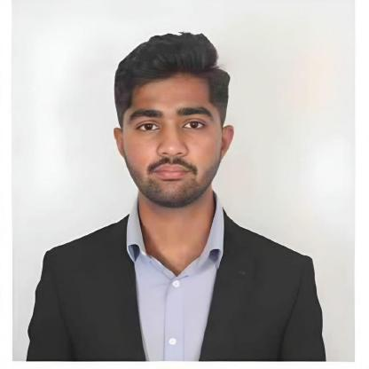 | 🇺🇸 Texas | **Gopi Trinadh** | Chapter Lead: Texas | [linkedin.com/in/gopitrinadhmaddikunta](https://www.linkedin.com/in/gopitrinadhmaddikunta/) |
| 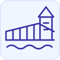 | 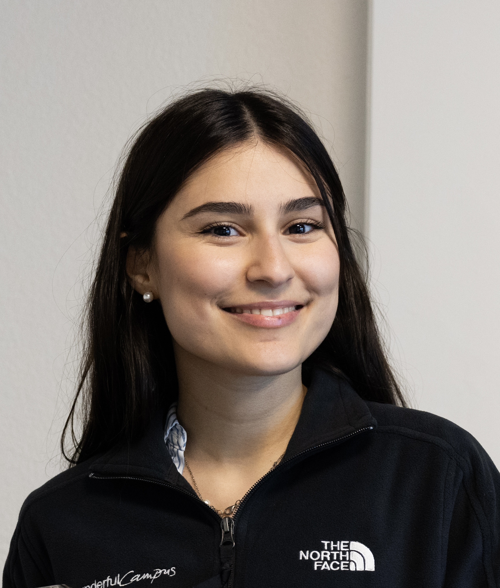 | 🇨🇭 Switzerland | **Elvan Konukseven** | Chapter Lead: Switzerland | [linkedin.com/in/elvan-konukseven](https://www.linkedin.com/in/elvan-konukseven/) |

---

## Maintainers

Maintainers have merge rights across the repository, lead technical direction, and
are the decision-makers when no consensus is reached among contributors.

| | Name | GitHub | LinkedIn |
|---|---|---|---|
|  | **Kannupriya Kalra** | [@kannupriyakalra](https://github.com/kannupriyakalra) | [linkedin.com/in/kannupriyakalra](https://www.linkedin.com/in/kannupriyakalra) |
|  | **Rory Graves** | [@rorygraves](https://github.com/rorygraves) | [linkedin.com/in/roryjgraves](https://www.linkedin.com/in/roryjgraves) |

---

## Steering Committee

The Steering Committee advises on overall technical priorities, module ownership, and
cross-cutting decisions. Members are recognised for sustained, high-quality contributions.

| | Name | GitHub | LinkedIn |
|---|---|---|---|
| 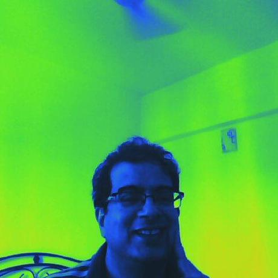 | **Atul S. Khot** | [@atulkhot](https://github.com/atulkhot) | [linkedin.com/in/atul-s-khot-035b4b1](https://www.linkedin.com/in/atul-s-khot-035b4b1) |
|  | **[Vitthal Mirji](https://vitthalmirji.com/)** | [@vim89](https://github.com/vim89) | [linkedin.com/in/vitthal10](https://www.linkedin.com/in/vitthal10/) |
| 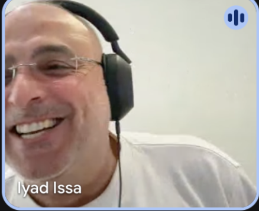 | **Iyad M. Issa** | [@iyadi](https://github.com/iyadi) | [linkedin.com/in/iyadissa](https://www.linkedin.com/in/iyadissa) |
|  | **Giovanni Ruggiero** | [@gruggiero](https://github.com/gruggiero) | [linkedin.com/in/giovanniruggiero](https://www.linkedin.com/in/giovanniruggiero) |
|  | **Dmitry Mamonov** | [@dmamonov](https://github.com/dmamonov) | [linkedin.com/in/dmamonov](https://www.linkedin.com/in/dmamonov) |

> This list is a starting point. Please add names via comments on
> [issue #1117](https://github.com/llm4s/llm4s/issues/1117) or a PR.

---

## Significant Individual Contributors

Significant individual contributors are active contributors with merged pull requests who participate in
project discussions and direction.

| | Name | GitHub | LinkedIn |
|---|---|---|---|
|  | **Vansh Sharma** | [@vansh7nvc](https://github.com/vansh7nvc) | [linkedin.com/in/vansh-sharma007392325](https://www.linkedin.com/in/vansh-sharma007392325) |
|  | **Elvan Konukseven** | [@elvankonukseven](https://github.com/elvankonukseven) | [https://www.linkedin.com/in/elvan-konukseven/](https://www.linkedin.com/in/elvan-konukseven/) |

> **Add yourself:** If you have merged PRs and would like to be listed here,
> open a PR adding your row.

---

## Security Committee

The Security Committee receives and handles reports of security vulnerabilities.
To report a security issue privately, see [`SECURITY.md`](https://github.com/llm4s/llm4s/blob/main/SECURITY.md).

| | Name | GitHub |
|---|---|---|
| 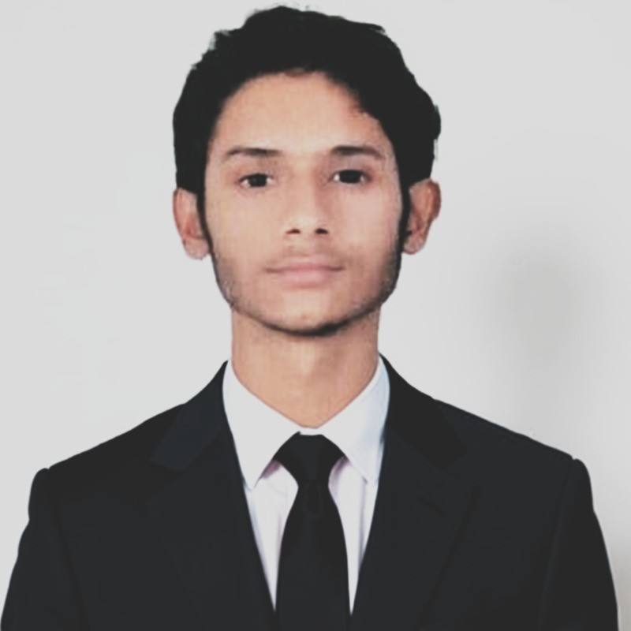 | **Anshuman Awasthi** | [@AnshumanAI](https://github.com/AnshumanAI) |
|  | **Rory Graves** | [@rorygraves](https://github.com/rorygraves) |

> Actively seeking additional members. Comment on [issue #1117](https://github.com/llm4s/llm4s/issues/1117) if you're interested.

---

## Code of Conduct Committee

See the [Code of Conduct](https://github.com/llm4s/llm4s/blob/main/CODE_OF_CONDUCT.md) for community standards and reporting guidance.

| Photo | Name | GitHub | LinkedIn |
|---|---|---|---|
|  | **Kannupriya Kalra** | [@kannupriyakalra](https://github.com/kannupriyakalra) | [linkedin.com/in/kannupriyakalra](https://www.linkedin.com/in/kannupriyakalra) |
|  | **[Vitthal Mirji](https://vitthalmirji.com/)** | [@vim89](https://github.com/vim89) | [linkedin.com/in/vitthal10](https://www.linkedin.com/in/vitthal10/) |
|  | **Shubham Vishwakarma** | [@Vi-shub](https://github.com/Vi-shub) | [linkedin.com/in/shubham-vish](https://www.linkedin.com/in/shubham-vish) |
|  | **Anshuman Awasthi** | [@AnshumanAI](https://github.com/AnshumanAI) | [linkedin.com/in/autodidact](https://www.linkedin.com/in/autodidact) |
|  | **Rory Graves** | [@rorygraves](https://github.com/rorygraves) | [linkedin.com/in/roryjgraves](https://www.linkedin.com/in/roryjgraves) |

---

## Social Media & Community Committee

The Social Media team manages the LLM4S presence on Discord, social platforms, events,
and community outreach.

| | Name | GitHub | LinkedIn |
|---|---|---|---|
|  | **Ansh K Shah** |  | [linkedin.com/in/ansh-k-shah](https://www.linkedin.com/in/ansh-k-shah/) |
|  | **Shubham Vishwakarma** | [@Vi-shub](https://github.com/Vi-shub) | [linkedin.com/in/shubham-vish](https://www.linkedin.com/in/shubham-vish) |
|  | **Gopi Trinadh** | [@GOPITRINADH3561](https://github.com/GOPITRINADH3561) | [https://www.linkedin.com/in/gopitrinadhmaddikunta/](https://www.linkedin.com/in/gopitrinadhmaddikunta/) |

> **Add yourself:** Open a PR or comment on [issue #1117](https://github.com/llm4s/llm4s/issues/1117).

---

## Contributors

Anyone who has had a pull request merged into the repository is a contributor.
The full contributor list is maintained automatically by GitHub:

[github.com/llm4s/llm4s/graphs/contributors](https://github.com/llm4s/llm4s/graphs/contributors)

---

## Volunteers

Volunteers support the project through non-code contributions: documentation, translation,
testing, design, and event support. To get involved, join the
[LLM4S Discord](https://discord.gg/llm4s) or open an issue.

---

## Becoming a Member

| Step | How |
|---|---|
| **Foundation Core Team** | Fund Foundation initiatives |
| **LLM4S Global Chapter Leader** | Organise local community events and provide leadership for the city’s LLM4S community |
| **Contributor** | Have a pull request merged |
| **Significant Individual Contributor** | Consistent, high-quality PRs over time; nominated by an existing member |
| **Steering Committee** | Recognised for sustained impact and broad project knowledge; invited by Directors |
| **Maintainer / Director** | Appointed by existing Directors for exceptional, long-term leadership |

Full criteria and the promotion process are documented in
[`GOVERNANCE.md`](https://github.com/llm4s/llm4s/blob/main/GOVERNANCE.md)
_(to be created; see [issue #1117](https://github.com/llm4s/llm4s/issues/1117))_.

---

## Emeritus

Former members who are no longer actively contributing. Their past contributions are
honoured permanently.

_No emeritus members yet. The project is young. This section will grow with time._

---

*Last updated: October 2026. To update this page, open a pull request.*
